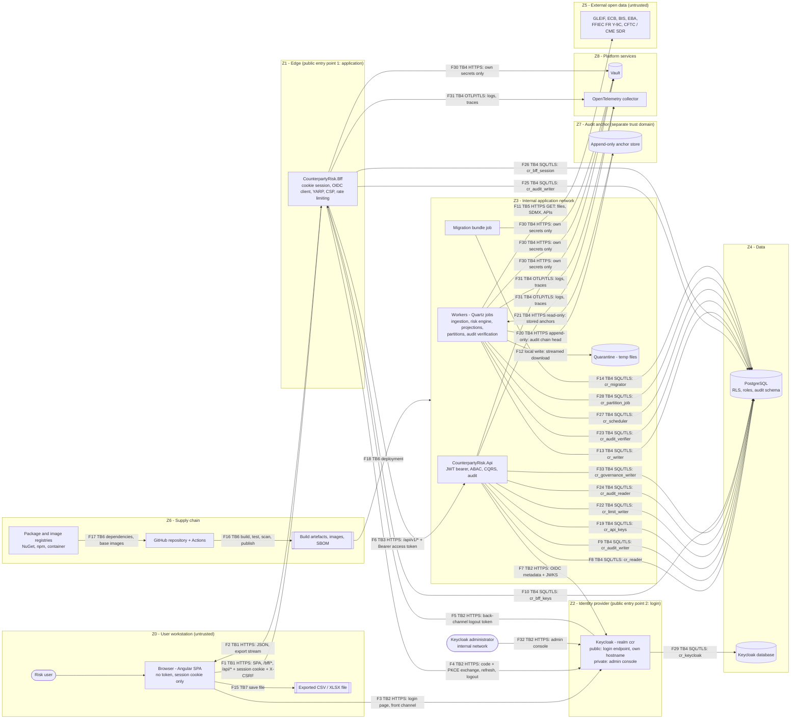

# Data flow diagram (DFD level 1)

Status: **v1.0** (issue #4). Companion of [threat-model.md](threat-model.md). Any new component, flow or
external source must be added here **and** analysed in the threat model before it is merged.

All identifiers in this document are synthetic. No hostname, URL or account below is a real deployment
value: `<...>` marks a placeholder.

## Diagram

The dashed blocks are trust zones. A flow that leaves a zone crosses a **trust boundary** `TB1` to `TB7`;
its label carries the boundary identifier.

## Public entry points

The system has **two** public entry points, on separate hostnames (SEC-041):

1. The BFF (Z1): SPA, `/bff/*` and `/api/*` (F1, F2).
2. The Keycloak login endpoint (Z2): the browser reaches it directly during the OIDC front channel (F3). Only the `ccr` realm paths needed for login are published.

The Keycloak admin console stays **private**: it is reachable from the internal network only (F32) and is not
published with the login endpoint. Everything else, including the API, has no public endpoint.

## Trust boundaries

| Id | Boundary | Crossing flows | Authentication across the boundary | Main controls |
| --- | --- | --- | --- | --- |
| TB1 | Browser to BFF (`CounterpartyRisk.Bff`), public entry point 1; the browser also reaches public entry point 2 directly, through TB2 (F3) | F1, F2 | Session cookie `__Host-ccr` (opaque key, server-side ticket) | TLS, cookie flags, `X-CSRF` header, CSP, rate limiting, audit |
| TB2 | BFF / browser / API / administrator to Keycloak; F3 crosses from the internet to public entry point 2, F32 stays on the internal network | F3, F4, F5, F7, F32 | OIDC Authorization Code + PKCE S256, confidential client `ccr-bff`; separate admin credentials for F32 | Exact redirect URIs, `state` / `nonce`, issuer and signature validation, MFA, brute force detection on the public login endpoint, admin console not published |
| TB3 | BFF to API (`CounterpartyRisk.Api`) | F6 | JWT access token, audience `ccr-api`, added server-side by YARP | API not exposed outside the internal network, JWT revalidated, ABAC per request |
| TB4 | Components to data, secret and telemetry stores (PostgreSQL, Keycloak database, audit anchors, vault, collector) | F8, F9, F10, F13, F14, F19-F31, F33 | One identity per **permission set**, not per component (see [Identities](#identities)) | Least privilege roles, `FORCE` RLS, TLS `VerifyFull`, parameterised SQL, separate key rings, external audit anchors |
| TB5 | Workers to external open data sources | F11, F12 | Server certificate only (sources are anonymous) | HTTPS, host allowlist, no cross-domain redirect, size limits, integrity checks, safe parsing, quarantine |
| TB6 | CI/CD (GitHub Actions) to repository, registries and artefacts | F16, F17, F18 | `GITHUB_TOKEN` with least permissions | Actions pinned by SHA, secret scanning, dependency and image scanning, SBOM, branch protection |
| TB7 | Export file to the user workstation | F15 | None (the file leaves the system) | Formula neutralisation, row cap, export policy, audit with file hash, licence filtering |

## Identities

This table is the **single reference** for service identities: `db/roles.sql` (#11) implements it. A component
holds several identities, with one connection each, and their privileges are never merged into one role. No
role has `SUPERUSER` or `BYPASSRLS`, and none has `UPDATE`, `DELETE` or `TRUNCATE` on `audit.audit_event`.

| Identity | Used by | Flows | Exact rights | RLS scope | Ticket |
| --- | --- | --- | --- | --- | --- |
| `cr_owner` | Nobody (`NOLOGIN`) | - | Owns all objects; runs the `SECURITY DEFINER` partition procedures | n/a | #11 |
| `cr_migrator` | Migration bundle only | F14 | Member of `cr_owner`: DDL, grants, RLS policies | n/a | #11 |
| `cr_reader` | API | F8 | `SELECT` on `ref`, `portfolio`, `financing`, `market`, `bench`, `calc`, `reporting`, `meta` | User scope | #11 |
| `cr_limit_writer` | API (`ManageLimits`, `ApproveLimitChange`, `ManageLimitThresholds`) | F22 | `SELECT`, `INSERT` on `portfolio.limit_change_request`; `SELECT`, `UPDATE` on `portfolio.limit`; `SELECT`, `INSERT` on `portfolio.threshold_policy`; no `DELETE` | User scope, `WITH CHECK` | #11, #27 |
| `cr_governance_writer` | API (`ManageMethodVersions`, `ApproveMethodVersion`, `ManageJobRuns`, `ManageHistoryCorrections`, `ApproveHistoryCorrection`) | F33 | `SELECT`, `INSERT` on `meta.method_version` and `meta.method_version_approval`; `UPDATE` of the status columns of `meta.method_version` only; `UPDATE` on `meta.active_method_version`; `SELECT`, `INSERT` on `meta.job_run_request`; `SELECT`, `INSERT` and status `UPDATE` on `meta.history_correction_request`; `INSERT` on `meta.risk_event` (type `HistoryCorrection` only); no `DELETE`, no access to `calc` | Explicit all-entities scope, required by rule R12 | #11, #19, #26 |
| `cr_audit_writer` | API, BFF | F9, F25 | `INSERT` on `audit.audit_event`; column-level `SELECT (seq, occurred_at, hash)` to read the previous hash of the chain and the generated values of `INSERT ... RETURNING` (never the payload) | None (no RLS on `audit`) | #10, #11 |
| `cr_audit_reader` | API (`ReadAudit` endpoint only) | F24 | `SELECT` on `audit.audit_event` | None; access controlled by `ReadAudit` | #10, #11 |
| `cr_audit_verifier` | Audit verification job only | F23 | `SELECT` on `audit.audit_event`; distinct from `cr_audit_reader` | None | #10, #11 |
| `cr_api_keys` | API | F19 | `SELECT`, `INSERT` on `dpkeys.api_key` | n/a | #11, #31 |
| `cr_bff_keys` | BFF | F10 | `SELECT`, `INSERT` on `dpkeys.bff_key` | n/a | #9, #11 |
| `cr_bff_session` | BFF | F26 | `SELECT`, `INSERT`, `UPDATE`, `DELETE` on `session.ticket` only (sliding expiry, revocation) | n/a | #9, #11 |
| `cr_writer` | Workers (ingestion, generators, engines, projections) | F13 | `SELECT`, `INSERT`, `UPDATE` on `ref`, `portfolio`, `market`, `bench`, `reporting` and the run tables of `meta`; `SELECT`, `INSERT` only on `calc` (results are snapshots, TM-TB4-07) and `INSERT` only on `financing`; `DELETE` / `TRUNCATE` on `staging` only. No default write grant on future `portfolio` tables: each is granted by its migration | Explicit all-entities scope (#26) | #11 |
| `cr_scheduler` | Quartz | F27 | Read / write on schema `quartz`, `meta.ingestion_run`; `SELECT` and status `UPDATE` on `meta.job_run_request`, `SELECT` on approved `meta.history_correction_request`; no write on `meta.method_version` or `meta.active_method_version` | n/a | #11, #19 |
| `cr_partition_job` | Partition and retention jobs | F28 | `EXECUTE` on `meta.ensure_partitions` and `meta.purge_partitions` only, no direct DDL; the purge excludes `audit` | n/a | #11, #19, #26 |
| `cr_keycloak` | Keycloak | F29 | Owner of the separate Keycloak database; no access to the application database | n/a | #9 |
| `anchor-publisher` | Audit verification job | F20 | Append only on the anchor store: no read, no delete | n/a | #10, #41 |
| `anchor-verifier` | Audit verification job | F21 | Read only on the anchor store | n/a | #10, #41 |
| Service identity per component | BFF, API, workers, migration job | F30 | Read its own secrets in the vault only | n/a | #10, #41 |

Capabilities of the [authorization matrix](threat-model.md#7-authorization-matrix-input-to-9-and-31) map to
database identities as follows. Every API call also uses `cr_audit_writer` when it is audited.

| Capability | Identity | Flow |
| --- | --- | --- |
| `ReadExposure`, `ReadLimits`, `ReadCva`, `ReadRiskOversight`, `ReadCapital`, `ReadMarketAndBenchmark`, `Export` | `cr_reader` | F8 |
| `ManageLimits`, `ApproveLimitChange`, `ManageLimitThresholds` | `cr_limit_writer` | F22 |
| `ReadAudit` | `cr_audit_reader` | F24 |
| `ManageMethodVersions`, `ApproveMethodVersion`, `ManageJobRuns`, `ManageHistoryCorrections`, `ApproveHistoryCorrection` | `cr_governance_writer` | F33 |
| `ReadDataQualityDetail` | `cr_reader` | F8 |

Separate connections cannot share a transaction, so a sensitive action and its audit event are not atomic. The
audit event is written **first** and refuses the action if it fails (fail-closed); a second event records the
outcome.

## Flows

| Flow | From | To | Data (class, see [data-classification.md](data-classification.md)) | Protocol | Boundary | Threats |
| --- | --- | --- | --- | --- | --- | --- |
| F1 | Browser | BFF | Requests, axis filters (C1), session cookie (C2 reference) | HTTPS, TLS 1.2+ | TB1 | TM-TB1-01, -02, -06, -07, -09 |
| F2 | BFF | Browser | SPA assets (C0), widget figures and exports (C1), `/bff/user` profile (C1-PD) | HTTPS | TB1 | TM-TB1-03, -04, -05, -10 |
| F3 | Browser | Keycloak | Username, password, OTP (C2 / C1-PD) | HTTPS | TB2 | TM-TB2-02 |
| F4 | BFF | Keycloak | Authorization code, PKCE verifier, client secret, tokens (C2) | HTTPS, back channel | TB2 | TM-TB2-01, -05 |
| F5 | Keycloak | BFF | Logout token (C2) | HTTPS, back channel | TB2 | TM-TB2-06 |
| F6 | BFF | API | Access token (C2), query parameters (C1) | HTTPS on the internal network | TB3 | TM-TB3-01 to -13 |
| F7 | API | Keycloak | Public signing keys, metadata (C0) | HTTPS | TB2 | TM-TB2-03 |
| F8 | API | PostgreSQL | Read models, portfolio and results (C1), RLS scope | PostgreSQL protocol over TLS | TB4 | TM-TB4-01, -02 |
| F9 | API | PostgreSQL | Audit events (C1-PD) | PostgreSQL over TLS | TB4 | TM-TB4-03 |
| F10 | BFF | PostgreSQL | BFF Data Protection key ring `dpkeys.bff_key` (C2, encrypted) | PostgreSQL over TLS | TB4 | TM-TB4-08 |
| F11 | Workers | External sources | Open data files and SDMX responses (C0, some non-redistributable) | HTTPS GET | TB5 | TM-TB5-01 to -11 |
| F12 | Workers | Quarantine | Raw downloaded files (C0, untrusted) | Local file system | inside Z3 | TM-TB5-05, -06 |
| F13 | Workers | PostgreSQL | Reference data, market data, synthetic portfolio, results (C0, C1) | PostgreSQL over TLS | TB4 | TM-TB4-02, -07 |
| F14 | Migration job | PostgreSQL | DDL, grants, RLS policies | PostgreSQL over TLS | TB4 | TM-TB4-02 |
| F15 | Browser | Workstation | Exported file (C1, synthetic, labelled) | File download | TB7 | TM-TB7-01 to -05 |
| F16 | GitHub Actions | Artefacts | Binaries, images, SBOM, scan reports | HTTPS | TB6 | TM-TB6-01, -03, -04, -05 |
| F17 | Registries | GitHub Actions | Third-party packages, actions, base images (untrusted until scanned) | HTTPS | TB6 | TM-TB6-02, -06 |
| F18 | Artefacts | Runtime | Signed images and bundles | HTTPS | TB6 | TM-TB6-06 |
| F19 | API | PostgreSQL | API Data Protection key ring `dpkeys.api_key` for cursor protection (C2, encrypted) | PostgreSQL over TLS | TB4 | TM-TB4-08 |
| F20 | Audit verification job (`anchor-publisher`) | Anchor store | Chain head (`seq`, HMAC, timestamp), hourly (C1) | HTTPS, append-only write | TB4 | TM-TB4-03 |
| F21 | Anchor store | Audit verification job (`anchor-verifier`) | Stored anchors, compared with the recomputed chain (C1) | HTTPS, read-only | TB4 | TM-TB4-03 |
| F22 | API | PostgreSQL | Limit change requests, approvals, limit amounts, thresholds (C1-PD for maker and checker, C1) | PostgreSQL over TLS | TB4 | TM-TB3-13, TM-TB4-02 |
| F23 | Audit verification job | PostgreSQL | Audit events read to recompute the chain (C1-PD) | PostgreSQL over TLS | TB4 | TM-TB4-03 |
| F24 | API | PostgreSQL | Audit events read for the `ReadAudit` endpoint (C1-PD) | PostgreSQL over TLS | TB4 | TM-TB4-12 |
| F25 | BFF | PostgreSQL | Audit events: login, logout, refusals, 429 (C1-PD) | PostgreSQL over TLS | TB4 | TM-TB2-08, TM-TB4-03 |
| F26 | BFF | PostgreSQL | Authentication tickets with tokens (C2, encrypted) | PostgreSQL over TLS | TB4 | TM-TB4-08 |
| F27 | Quartz | PostgreSQL | Job definitions, triggers, run status (C1) | PostgreSQL over TLS | TB4 | TM-TB4-13 |
| F28 | Partition and retention jobs | PostgreSQL | Calls to partition procedures, no data | PostgreSQL over TLS | TB4 | TM-TB4-09, -14 |
| F29 | Keycloak | Keycloak database | Accounts, hashed credentials, sessions, events (C1-PD, C2) | PostgreSQL over TLS | TB4 | TM-TB4-15 |
| F30 | BFF, API, workers, migration job | Vault | Own secrets and keys (C2) | HTTPS, service identity | TB4 | TM-TB4-04, -10 |
| F31 | BFF, API, workers | Collector | Logs and traces (C1, no secret) | OTLP over TLS | TB4 | TM-TB4-05, -11 |
| F32 | Keycloak administrator | Keycloak | Admin console: accounts, roles, sessions (C1-PD, C2) | HTTPS, internal network | TB2 | TM-TB2-04, -07, -09 |
| F33 | API | PostgreSQL | Method version publications, approvals and rejections, active version pointer, history correction requests and their W12 annotation, queued job run requests (C1-PD for publisher and approver, C1) | PostgreSQL over TLS | TB4 | TM-TB3-08, -14, -15, TM-TB4-02 |

## Rules for evolving this diagram

- A new external endpoint, a new public route on the BFF, a new database role, a WebSocket / SignalR channel,
  an external ORE or pricing engine, or a new file upload feature is a **new flow**: update this diagram,
  add the STRIDE rows in [threat-model.md](threat-model.md) and the ASVS rows in
  [asvs-l2-checklist.md](asvs-l2-checklist.md) in the same pull request.
- The API must never get a public endpoint: if a deployment needs one, TB3 becomes an internet-facing
  boundary and the threat model must be revised first.
- A distributed server cache for `HybridCache` would be a new flow: V1 uses an in-process cache only.
