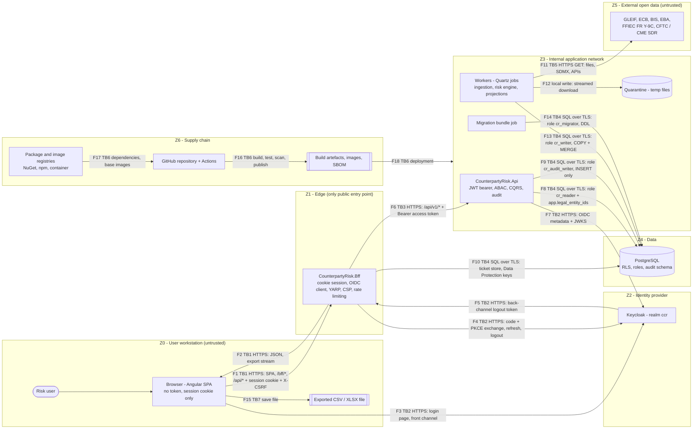

# Data flow diagram (DFD level 1)

Status: **v1.0** (issue #4). Companion of [threat-model.md](threat-model.md). Any new component, flow or
external source must be added here **and** analysed in the threat model before it is merged.

All identifiers in this document are synthetic. No hostname, URL or account below is a real deployment
value: `<...>` marks a placeholder.

## Diagram

The dashed blocks are trust zones. A flow that leaves a zone crosses a **trust boundary** `TB1` to `TB7`;
its label carries the boundary identifier.

## Trust boundaries

| Id | Boundary | Crossing flows | Authentication across the boundary | Main controls |
| --- | --- | --- | --- | --- |
| TB1 | Browser to BFF (`CounterpartyRisk.Bff`) | F1, F2 | Session cookie `__Host-ccr` (opaque key, server-side ticket) | TLS, cookie flags, `X-CSRF` header, CSP, rate limiting, audit |
| TB2 | BFF / browser / API to Keycloak | F3, F4, F5, F7 | OIDC Authorization Code + PKCE S256, confidential client `ccr-bff` | Exact redirect URIs, `state` / `nonce`, issuer and signature validation, MFA |
| TB3 | BFF to API (`CounterpartyRisk.Api`) | F6 | JWT access token, audience `ccr-api`, added server-side by YARP | API not exposed outside the internal network, JWT revalidated, ABAC per request |
| TB4 | API / BFF / workers / migrations to PostgreSQL | F8, F9, F10, F13, F14 | One database role per component | Least privilege roles, `FORCE` RLS, TLS `VerifyFull`, parameterised SQL |
| TB5 | Workers to external open data sources | F11, F12 | Server certificate only (sources are anonymous) | HTTPS, host allowlist, no cross-domain redirect, size limits, integrity checks, safe parsing, quarantine |
| TB6 | CI/CD (GitHub Actions) to repository, registries and artefacts | F16, F17, F18 | `GITHUB_TOKEN` with least permissions | Actions pinned by SHA, secret scanning, dependency and image scanning, SBOM, branch protection |
| TB7 | Export file to the user workstation | F15 | None (the file leaves the system) | Formula neutralisation, row cap, export policy, audit with file hash, licence filtering |

Database role names follow #11 and #10: `cr_owner` (NOLOGIN owner), `cr_migrator`, `cr_writer`,
`cr_reader`, `cr_audit_writer`, `cr_audit_reader`. They implement the `app_api` (read) / `app_worker` (write)
split described in the issue.

## Flows

| Flow | From | To | Data (class, see [data-classification.md](data-classification.md)) | Protocol | Boundary |
| --- | --- | --- | --- | --- | --- |
| F1 | Browser | BFF | Requests, axis filters (C1), session cookie (C2 reference) | HTTPS, TLS 1.2+ | TB1 |
| F2 | BFF | Browser | SPA assets (C0), widget figures and exports (C1), `/bff/user` profile (C1-PD) | HTTPS | TB1 |
| F3 | Browser | Keycloak | Username, password, OTP (C2 / C1-PD) | HTTPS | TB2 |
| F4 | BFF | Keycloak | Authorization code, PKCE verifier, client secret, tokens (C2) | HTTPS, back channel | TB2 |
| F5 | Keycloak | BFF | Logout token (C2) | HTTPS, back channel | TB2 |
| F6 | BFF | API | Access token (C2), query parameters (C1) | HTTPS on the internal network | TB3 |
| F7 | API | Keycloak | Public signing keys, metadata (C0) | HTTPS | TB2 |
| F8 | API | PostgreSQL | Read models, portfolio and results (C1), RLS scope | PostgreSQL protocol over TLS | TB4 |
| F9 | API | PostgreSQL | Audit events (C1-PD) | PostgreSQL over TLS | TB4 |
| F10 | BFF | PostgreSQL | Authentication tickets with tokens, Data Protection key ring (C2, encrypted) | PostgreSQL over TLS | TB4 |
| F11 | Workers | External sources | Open data files and SDMX responses (C0, some non-redistributable) | HTTPS GET | TB5 |
| F12 | Workers | Quarantine | Raw downloaded files (C0, untrusted) | Local file system | inside Z3 |
| F13 | Workers | PostgreSQL | Reference data, market data, synthetic portfolio, results (C0, C1) | PostgreSQL over TLS | TB4 |
| F14 | Migration job | PostgreSQL | DDL, grants, RLS policies | PostgreSQL over TLS | TB4 |
| F15 | Browser | Workstation | Exported file (C1, synthetic, labelled) | File download | TB7 |
| F16 | GitHub Actions | Artefacts | Binaries, images, SBOM, scan reports | HTTPS | TB6 |
| F17 | Registries | GitHub Actions | Third-party packages, actions, base images (untrusted until scanned) | HTTPS | TB6 |
| F18 | Artefacts | Runtime | Signed images and bundles | HTTPS | TB6 |

## Rules for evolving this diagram

- A new external endpoint, a new public route on the BFF, a new database role, a WebSocket / SignalR channel,
  an external ORE or pricing engine, or a new file upload feature is a **new flow**: update this diagram,
  add the STRIDE rows in [threat-model.md](threat-model.md) and the ASVS rows in
  [asvs-l2-checklist.md](asvs-l2-checklist.md) in the same pull request.
- The API must never get a public endpoint: if a deployment needs one, TB3 becomes an internet-facing
  boundary and the threat model must be revised first.
