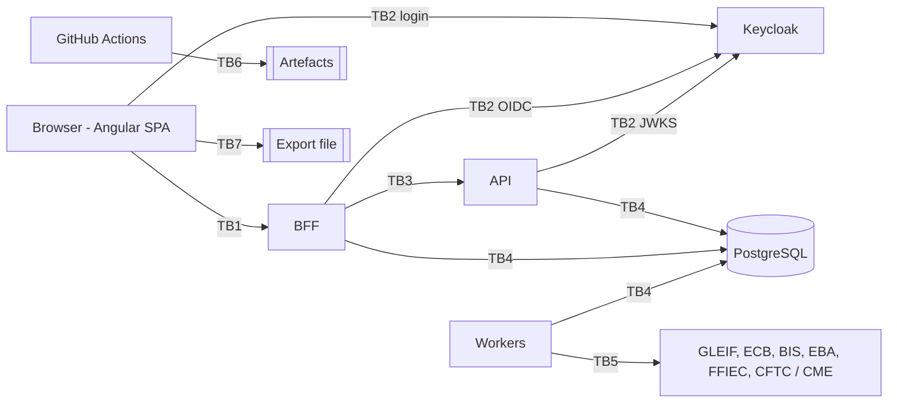

# Threat model (STRIDE)

Status: **v1.0** (issue #4) - owner: Lead - next formal review: #38 (DAST and end-to-end security review).

Related documents:
[data-flow.md](data-flow.md) (detailed DFD and flows F1-F18) ·
[asvs-l2-checklist.md](asvs-l2-checklist.md) (requirements `SEC-nnn`) ·
[data-classification.md](data-classification.md) ·
[external-sources.md](external-sources.md).

## 1. Scope and assumptions

**In scope**: the browser (Angular SPA), `CounterpartyRisk.Bff`, `CounterpartyRisk.Api`, the workers
(ingestion, risk engine, projections, Quartz scheduling), PostgreSQL, Keycloak (realm `ccr`), the external
open data sources (GLEIF, ECB, BIS, EBA, FFIEC FR Y-9C, CFTC / CME SDR), the CI/CD pipeline and the export
files.

**Assumptions**

- The portfolio is synthetic, but it is **handled as if it were confidential** (class C1) so that access
  control, audit and export controls are exercised for real.
- The API is reachable only from the BFF (internal network). There are two public entry points: the BFF and the Keycloak login endpoint, on its own hostname. The Keycloak admin console stays private (F32).
- Users are authenticated employees with a role and a data scope (legal entities, business lines) carried
  by Keycloak attributes. The scope never comes from the client.
- Hosting platform, network segmentation and TLS termination are covered by the deployment runbook (#41);
  this model states the requirements they must meet.

**Out of scope**: physical security, the security of the open data publishers themselves, the user's
workstation once a file has been exported (see residual risks).

## 2. Assets

| Asset | Class | Why it matters |
| --- | --- | --- |
| Portfolio, exposures, limits, capital figures (synthetic) | C1 | Confidential in a real bank: cross-entity disclosure is the main business risk |
| Session tickets, access / refresh tokens, Data Protection keys | C2 | Account takeover |
| Secrets: client secret, database passwords, HMAC key | C2 | Full compromise |
| Audit trail | C1-PD | Non-repudiation, regulatory traceability |
| User accounts (Keycloak) and their scope attributes | C1-PD | Privilege escalation, personal data |
| Reference and market data (GLEIF, ECB, BIS, EBA, FR Y-9C, SDR) | C0 | Integrity of every computed figure |
| Source code, workflows, build artefacts | C1 | Supply chain |

## 3. Overview diagram

Detailed flows and their numbering are in [data-flow.md](data-flow.md).

## 4. Method and rating

- STRIDE is applied **per trust boundary** (flows crossing it) and then summarised **per component**
  (section 6). Each threat has an identifier `TM-<boundary>-<n>`; threats inside a zone use `TM-INT-<n>`.
- Severity = likelihood x impact, rated **High**, **Medium** or **Low**. Every **High** threat has a named
  abuse-case test, owned by the ticket that implements the mitigation and replayed by #38.
- `SEC-nnn` refers to the requirement rows of [asvs-l2-checklist.md](asvs-l2-checklist.md).

## 5. STRIDE per trust boundary

### TB1 - Browser to BFF (flows F1, F2)

| Id | STRIDE | Threat (concrete example) | Sev. | Mitigation | Requirements | Ticket | Abuse-case test |
| --- | --- | --- | --- | --- | --- | --- | --- |
| TM-TB1-01 | S | Session cookie theft (XSS, network sniffing, malware) then replay | High | Cookie `__Host-ccr`, `HttpOnly`, `Secure`, `SameSite=Strict`; cookie holds only a ticket key, tokens stay server-side; idle 30 min, absolute 10 h; server-side revocation on logout | SEC-028..031, SEC-087..093 | #9 | `Should_Not_Expose_Any_Token_To_The_Browser`, `Should_Return401_When_Cookie_Is_Replayed_After_Logout` |
| TM-TB1-02 | S / T | Cross-site request forgery on `/api/**` or on logout | High | `SameSite=Strict` + mandatory `X-CSRF: 1` header on every `/api/**` call (forces a CORS preflight, CORS disabled) + antiforgery token on `POST /bff/logout` | SEC-038..040 | #9 | `Should_Return403_When_Api_Call_Lacks_Csrf_Header` |
| TM-TB1-03 | T / E | Stored XSS through untrusted open data, e.g. a GLEIF legal name containing markup, rendered in AG Grid or a Highcharts tooltip | High | Angular interpolation only, no `innerHTML` / `bypassSecurityTrust*` (lint rule), AG Grid text renderers, Highcharts `useHTML: false`; strict CSP with nonce and Trusted Types | SEC-003, SEC-008, SEC-027, SEC-034 | #10, #12, #14 | `Should_Render_Counterparty_Name_As_Text`, `Should_Block_Inline_Script_With_Csp` |
| TM-TB1-04 | I | Risk figures cached by the browser or an intermediate proxy, or left in browser storage after logout | Medium | `Cache-Control: no-store` on `/api/**` and `/bff/user`; `Clear-Site-Data` on logout; no figures in `localStorage` | SEC-181..183 | #9, #10, #13 | - |
| TM-TB1-05 | T | Clickjacking of the dashboard | Low | CSP `frame-ancestors 'none'` (+ `X-Frame-Options: DENY`) | SEC-037 | #10 | - |
| TM-TB1-06 | D | Flood of costly aggregation queries (all axes, all dates) or repeated exports | High | Rate limiting per `sub` (`query`, `export`, `login` policies), concurrency limiter, `QueueLimit=0`, page size capped at 500, `statement_timeout` 10 s, one concurrent export per user | SEC-025, SEC-186, SEC-188 | #10, #31, #39 | `Should_Return429_When_Export_Rate_Is_Exceeded` |
| TM-TB1-07 | S | Forged `X-Forwarded-For` to bypass rate limiting or falsify the audited IP | Medium | `UseForwardedHeaders` with explicit `KnownProxies` only; YARP overwrites forwarding headers | SEC-046, SEC-193 | #10 | - |
| TM-TB1-08 | R | A user denies having exported a portfolio | High | Append-only, hash-chained audit trail: actor (`iss` + `sub`), effective scope, allow-listed filters, row count, SHA-256 of the file; audit written before the first byte (fail-closed) | SEC-198, SEC-204, SEC-208 | #10, #31 | `Should_Write_Audit_Event_With_Export_Hash` |
| TM-TB1-09 | S | Open redirect through the `returnUrl` of `/bff/login` used for phishing | Medium | Only local, relative return URLs accepted | SEC-043 | #9 | - |
| TM-TB1-10 | I | Stack traces or SQL errors returned to the browser | Medium | Generic `ProblemDetails` (RFC 9457), no exception details outside `Development` | SEC-210 | #7, #10 | - |

### TB2 - BFF, browser, API and administrator to Keycloak (flows F3, F4, F5, F7, F32)

| Id | STRIDE | Threat (concrete example) | Sev. | Mitigation | Requirements | Ticket | Abuse-case test |
| --- | --- | --- | --- | --- | --- | --- | --- |
| TM-TB2-01 | S | Authorization code interception or injection, login CSRF | High | Code flow + PKCE S256 required by the client, `state` and `nonce` bound to the browser session, exact redirect URIs (no wildcard), confidential client | SEC-117, SEC-118, SEC-123, SEC-128, SEC-134 | #9 | `Should_Reject_Callback_With_Invalid_State` |
| TM-TB2-02 | S | Credential stuffing or password brute force on the Keycloak login page | High | Keycloak brute force detection (temporary lockout, no permanent lockout), password policy (length 15+, deny list, no composition rules), **MFA (TOTP) required**, rate limit on `/bff/login`; the public Keycloak login endpoint (F3) does not go through the BFF, so it relies on Keycloak brute force detection | SEC-056..074 | #9, #10 | `Should_Lock_Account_Temporarily_After_Repeated_Failures` |
| TM-TB2-03 | S | Forged token presented to the API: other signing key, `alg=none`, algorithm confusion, wrong audience, expired, ID token used as access token | High | `JwtBearer` with fixed authority, keys only from the issuer metadata, algorithm allowlist **PS256** (RSA-PSS, 3072-bit keys), audience `ccr-api`, lifetime checked, clock skew <= 30 s, token type checked | SEC-082, SEC-109..115 | #9 | `Should_Return401_When_Token_Is_Signed_By_Another_Key`, `Should_Return401_When_Audience_Is_Not_CcrApi`, `Should_Return401_When_Token_Is_Expired`, `Should_Return401_When_Id_Token_Is_Presented` |
| TM-TB2-04 | T / E | Realm misconfiguration: implicit or password grant enabled, wildcard redirect URI, extra scopes | Medium | Realm versioned as code (`ccr-realm.json`), automated realm test on grants, redirect URIs, PKCE method, scopes | SEC-123..133, SEC-139 | #9 | `Realm_Should_Only_Enable_Code_Flow_With_Pkce` |
| TM-TB2-05 | I | Leak of the `ccr-bff` client secret or of the Keycloak admin password | High | Secret injected at import time (`${CCR_BFF_CLIENT_SECRET}`), provided by Aspire secret parameters / vault; gitleaks on the realm file; startup validation rejects demo values | SEC-165, SEC-168, SEC-169 | #9, #10 | `Should_Refuse_To_Start_When_Secret_Is_Missing_Or_Default` |
| TM-TB2-06 | D | Forced logout of users with a forged back-channel logout token | Medium | Logout token validated: signature, issuer, audience, `typ=logout+jwt`, `events` claim, no `nonce` | SEC-138 | #9 | - |
| TM-TB2-07 | E | Keycloak admin console reachable from the user network, default admin account | Medium | Only the login paths of realm `ccr` are published; the admin console is reachable from the internal network only (F32); bootstrap admin from a secret parameter, `ccr` realm has no admin users | SEC-072, SEC-165 | #9, #41 | - |
| TM-TB2-08 | R | Login, failed login or logout cannot be traced | Medium | Keycloak user and admin events enabled; BFF audits login / logout | SEC-203 | #9, #10 | - |
| TM-TB2-09 | E | Segregation of duties broken: one account cumulates incompatible roles (e.g. `ccr-limit-admin` + `ccr-front-office`, or `ccr-auditor` + a business role) | High | Incompatible role pairs (section 7.3) checked on the realm and on every access token (403); startup validation of the table | SEC-102, SEC-120 | #9 | `Realm_Should_Not_Assign_Incompatible_Roles`, `Should_Return403_When_Token_Has_Incompatible_Roles` |

### TB3 - BFF to API (flow F6)

| Id | STRIDE | Threat (concrete example) | Sev. | Mitigation | Requirements | Ticket | Abuse-case test |
| --- | --- | --- | --- | --- | --- | --- | --- |
| TM-TB3-01 | S | Direct call to the API that bypasses the BFF (no CSRF check, no session) | Medium | API has no public endpoint (internal network only) and revalidates every JWT; `FallbackPolicy` = authenticated user | SEC-107, SEC-109 | #7, #9 | - |
| TM-TB3-02 | I | IDOR / BOLA: a user reads the figures of another legal entity (filter `legalEntities=<other LEI>` or a `publicId` of a foreign netting set) | High | `AuthorizationBehavior`: missing filter replaced by the user scope, out-of-scope filter -> 403, out-of-scope or unknown identifier -> identical 404; scope only from the token; PostgreSQL RLS as second layer | SEC-105, SEC-107, SEC-108, SEC-120 | #9, #11, #31 | `Should_Return403_When_User_Requests_Other_LegalEntity`, `Should_Return404_When_NettingSet_Is_Out_Of_Scope`, `Should_Return403_And_Issue_No_Sql_When_Scope_Is_Empty` |
| TM-TB3-03 | E | BFLA: a front-office user calls capital (W5/W6), oversight (W10/W11) or export endpoints, or reads a capital figure through an aggregate widget (RWA tile of W1, W12 series) | High | Named capability policies on each endpoint group, deny by default, automated "every endpoint has a policy" test, field-level rules R1, R3 and R8 enforced by the API (fields not returned, not just hidden), authorization matrix (section 7) | SEC-102, SEC-103, SEC-104 | #9, #31 | `Should_Return403_When_FrontOffice_Calls_Capital_Endpoint`, `Should_Not_Return_Rwa_Tile_In_W1_For_FrontOffice`, `Should_Return403_When_W12_Series_Requires_Missing_Capability`, `Should_Not_Return_Utilisation_To_LimitAdmin`, `Every_Endpoint_Should_Have_A_Named_Policy` |
| TM-TB3-04 | E / T | SQL injection through a dynamic group-by axis or sort field turned into SQL | High | Axes and sort fields are enums mapped to columns, parameterised queries only, never concatenated SQL; CodeQL | SEC-006, SEC-018 | #31, #8 | `Should_Return400_When_Sort_Field_Is_Not_Allowlisted` |
| TM-TB3-05 | T | Pagination cursor tampered with, replayed by another user, or reused after expiry | Medium | Cursor protected by a time-limited Data Protection protector of the API key ring (`ccr-api`, see TM-TB4-08) containing last key, filter hash and `sub` | SEC-148 | #31 | - |
| TM-TB3-06 | I | BOPLA: internal keys, `run_id`, `input_hash` or technical columns exposed | Medium | Dedicated DTOs, `public_id` UUIDv4 distinct from internal keys | SEC-106, SEC-190 | #31 | - |
| TM-TB3-07 | I | A user restricted to one business line sees the full netting set measure (PFE, EAD, RWA) | Medium | Business-line filtering only through allocated facts (#25); field-level rules in the authorization matrix | SEC-103, SEC-106 | #9, #25, #31 | - |
| TM-TB3-08 | D | A query triggers a Monte-Carlo run or a history recomputation, exhausting the engine | High | No API endpoint triggers a simulation; computations run only as scheduled jobs; reads hit precomputed read models; `statement_timeout` | SEC-186, SEC-188 | #22, #26, #31, #39 | `Should_Abort_Query_When_Statement_Timeout_Is_Exceeded` |
| TM-TB3-09 | I | Server cache returns figures computed for another scope | Medium | `HybridCache` key includes the hash of the effective scope, filters and `published_run_id` | SEC-178 | #31 | - |
| TM-TB3-10 | S / E | Client-supplied `Authorization`, `X-Forwarded-*` or `X-User-*` header passed through the proxy | Medium | YARP transform removes `Cookie` and any client `Authorization`, then adds the server-side token | SEC-046 | #9 | `Should_Strip_Client_Authorization_Header_Before_Proxying` |
| TM-TB3-11 | T | Misleading figures: economic and regulatory measures mixed, benchmark presented as recomputed value | Medium | `meta.exposureLevel`, `meta.measureKind`, `lineage` mandatory in every response; benchmarks served by distinct endpoints under `ReadMarketAndBenchmark`, with attribution (rule R6) | SEC-020, SEC-102 | #5, #31 | `Benchmark_Response_Should_Carry_Attribution_And_Separate_Series` |
| TM-TB3-12 | I | Large-exposure ratio (exposure / Tier 1) of W10 returned to a user without `ReadCapital`, or computed on a business-line subset (capital leak and misleading ratio) | High | Rule R2: row returned only with `ReadCapital` and a scope covering all business lines of the legal entity; never allocated to a business line | SEC-103, SEC-105 | #9, #30, #31 | `Should_Not_Return_LargeExposure_Ratio_Without_Full_Entity_Scope` |
| TM-TB3-13 | E / T / R | Limit amount changed without independent approval: maker approves its own change, front office modifies a limit it consumes, a pending change already feeds W4, change cannot be traced | High | `ManageLimits` (limit-admin) and `ApproveLimitChange` (direction) separated; maker != checker on `sub`, in the handler and by a database `CHECK`; writes through `cr_limit_writer` only (F22) with RLS `WITH CHECK`; pending changes excluded from W4 utilisation; audit of old value, new value, maker, checker, timestamp (rule R4) | SEC-021, SEC-104, SEC-192, SEC-198 | #10, #27, #31 | `Should_Return403_When_Maker_Approves_Own_Limit_Change`, `Should_Return403_When_FrontOffice_Calls_ManageLimits`, `Should_Not_Use_Pending_Limit_Change_In_W4_Utilisation` |

### TB4 - Components to data, secret and telemetry stores (flows F8, F9, F10, F13, F14, F19-F31)

Service identities and their exact rights are defined in [data-flow.md](data-flow.md#identities).

| Id | STRIDE | Threat (concrete example) | Sev. | Mitigation | Requirements | Ticket | Abuse-case test |
| --- | --- | --- | --- | --- | --- | --- | --- |
| TM-TB4-01 | I | RLS bypass: new table without policy, view without `security_invoker`, role with `BYPASSRLS`, scope variable leaking across pooled connections | High | `ENABLE` + `FORCE ROW LEVEL SECURITY`, `WITH CHECK`, `set_config(..., true)` scoped to the transaction, fail-closed when unset, tests on `pg_class.relrowsecurity` and view options | SEC-108, SEC-212 | #11, #43 | `Should_Return_Zero_Rows_When_Scope_Is_Not_Set`, `All_Tables_With_LegalEntityId_Should_Have_Forced_Rls` |
| TM-TB4-02 | E | A compromised API process writes or alters data, or runs DDL | High | One identity per permission set (data-flow.md): `cr_reader` SELECT only; the only business write role of the API is `cr_limit_writer`, limited to the limit tables and subject to RLS `WITH CHECK`; `cr_writer` for workers only; `cr_migrator` only for the migration bundle; no `SUPERUSER` / `BYPASSRLS`; the API never migrates | SEC-164 | #11, #27 | `CrReader_Should_Not_Insert_Update_Delete_Or_Alter`, `CrLimitWriter_Should_Not_Write_Outside_Limit_Tables`, `Should_Reject_Limit_Change_Outside_Scope` |
| TM-TB4-03 | T / R | Audit trail tampering (update, delete, truncation), including by a PostgreSQL superuser who recomputes the chain | High | `cr_audit_writer` limited to INSERT and column-level `SELECT (seq, hash)` to chain the previous hash, trigger rejecting UPDATE / DELETE; **keyed** chain `HMAC-SHA-256(key, prev_hash ‖ row)` with the key in the vault, outside PostgreSQL; chain head (`seq`, HMAC) anchored every hour in an append-only store of a separate trust domain by an append-only publisher identity (F20); scheduled verification reads the events with `cr_audit_verifier` (F23) and the anchors with a separate read-only identity (F21), compares them with the recomputed chain and raises an alert. Detects: any modification, deletion, insertion or truncation of rows up to the last anchor, even by a DBA (who cannot recompute the HMAC without the key). Does not detect: truncation of events written after the last anchor (window <= 1 h), or forged events appended by a compromised audit writer that holds the key | SEC-208 | #10 | `Should_Detect_Broken_Audit_Chain_At_Exact_Sequence`, `Should_Detect_Recomputed_Chain_Against_External_Anchor`, `CrAuditWriter_Should_Only_Read_Seq_And_Hash`, `CrAuditVerifier_Should_Only_Read_Audit_Events` |
| TM-TB4-04 | I | Database credentials leaked (repository, logs, image) or connection without TLS | High | Secrets store, no password in `appsettings`, `SSL Mode=VerifyFull` outside local, startup validation | SEC-158, SEC-163, SEC-168 | #10, #11 | `Appsettings_Should_Not_Contain_Secrets` |
| TM-TB4-05 | I | Amounts, LEIs or SQL parameters written to logs | Medium | No `EnableSensitiveDataLogging`, `LogParameters=false`, `Include Error Detail=false` outside `Development` | SEC-202 | #10, #11 | - |
| TM-TB4-06 | I | Foreign-key error used as a side channel to learn that a row exists in another entity | Low | Business tables are written by `cr_writer` jobs, and by `cr_limit_writer` for limit tables only; database errors never reach the client | SEC-210 | #43 | - |
| TM-TB4-07 | T | Historical results silently rewritten (calc, financing snapshots) | Medium | INSERT-only grants on snapshots, `method_version_id` and `lineage` NOT NULL, regeneration through a new ingestion run | SEC-023 | #11, #26, #43 | - |
| TM-TB4-08 | S / T | Theft of the ticket store or of a Data Protection key ring from the database, allowing cookie or cursor forgery | Medium | Tickets in `session.ticket`, role `cr_bff_session` only (F26). Two separate key rings: BFF (`ccr-bff`, table `dpkeys.bff_key`, role `cr_bff_keys`, flow F10) and API (`ccr-api`, table `dpkeys.api_key`, role `cr_api_keys`, flow F19); each table readable and insertable only by its own role, never by `cr_reader`; keys encrypted at rest with key-encryption keys from the vault; tokens stored inside protected tickets | SEC-147, SEC-148, SEC-164 | #9, #31 | - |
| TM-TB4-09 | D | Rows landing in the `DEFAULT` partition, unbounded table growth | Low | `meta.ensure_partitions` M+3, monitoring of `DEFAULT`, retention by partition detach | - | #11, #19 | - |
| TM-TB4-10 | I | A compromised component reads the secrets of another component in the vault | Medium | One service identity per component, each limited to its own secrets (F30); audit chain key readable only by the audit writers and the verification job | SEC-168, SEC-169 | #10, #41 | - |
| TM-TB4-11 | T / I | Logs intercepted in transit or altered on the application host | Medium | OTLP over TLS to a collector separate from the application (F31), RBAC on the collector, no secret in logs | SEC-202, SEC-209 | #7, #10, #41 | - |
| TM-TB4-12 | I | Audit trail (C1-PD) read outside the `ReadAudit` endpoint | Medium | `cr_audit_reader` connection used only by the audit read handler, behind `ReadAudit`; `cr_reader` has no access to `audit` | SEC-164, SEC-208 | #10, #11 | - |
| TM-TB4-13 | T | Quartz schedule altered to disable a control (audit verification, data quality) or to run a job with forged data | Medium | `cr_scheduler` limited to `quartz` and `meta.ingestion_run`; jobs defined in code; alert when the verification job stops running | SEC-014, SEC-164 | #11, #19 | - |
| TM-TB4-14 | E / T | Partition maintenance abused to run DDL or to drop history or audit data | Medium | `cr_partition_job` has `EXECUTE` only on two `SECURITY DEFINER` procedures with validated parameters; the purge excludes `audit`, whose partitions are only detached by a traced operating procedure | SEC-164 | #11, #19, #26 | - |
| TM-TB4-15 | I / E | Keycloak database access exposes hashed credentials and sessions, or a Keycloak compromise reaches application data | Medium | Separate database, `cr_keycloak` has no access to the application database, TLS, password hashing by Keycloak | SEC-150, SEC-164 | #9, #41 | - |

### TB5 - Workers to external open data sources (flows F11, F12)

| Id | STRIDE | Threat (concrete example) | Sev. | Mitigation | Requirements | Ticket | Abuse-case test |
| --- | --- | --- | --- | --- | --- | --- | --- |
| TM-TB5-01 | S | Source impersonation through DNS spoofing or TLS interception, or redirect to an attacker host | High | HTTPS only, TLS 1.2+, default certificate validation (no custom callback), one named `HttpClient` per source with a host allowlist, `AllowAutoRedirect=false` and manual redirects revalidated | SEC-158, SEC-159, SEC-166, SEC-167, SEC-191 | #15, #16, #17, #18 | `Should_Reject_Redirect_To_Non_Allowlisted_Host` |
| TM-TB5-02 | I / S | SSRF: a download URL returned by a source API (GLEIF publishes endpoint) points to an internal address | High | Every URL obtained from a response is validated against the source allowlist (scheme, host, port) before use | SEC-010 | #15, #17 | `Should_Reject_Download_Url_Outside_Allowlist` |
| TM-TB5-03 | T | Altered, truncated or replayed file (GLEIF, ECB, BIS, EBA, FR Y-9C, SDR) | High | SHA-256 computed while streaming and stored in `meta.ingestion_run`, announced size checked, record counts reconciled, schema validated before load, invalid files quarantined then deleted | SEC-049, SEC-050, SEC-151 | #15, #16, #17, #19 | `Should_Reject_File_When_Size_Differs_From_Announced` |
| TM-TB5-04 | E / D | XXE or entity expansion (billion laughs) in SDMX-ML or LEI-CDF XML | High | `XmlReader` with `DtdProcessing.Prohibit`, `XmlResolver = null`, `MaxCharactersFromEntities = 0`, streaming only (never `XmlDocument`) | SEC-013 | #15, #16, #17 | `Should_Reject_Xml_With_Dtd` |
| TM-TB5-05 | D | Zip bomb or oversized file (GLEIF level 1 is several GB once decompressed) | High | Download size cap, uncompressed size cap, compression ratio cap, expected entry count (1 for GLEIF), streaming parse, global timeout | SEC-049, SEC-051 | #15, #17 | `Should_Reject_Zip_Exceeding_Uncompressed_Limit` |
| TM-TB5-06 | T / E | Zip slip: archive entry `../../app/x.dll` or an absolute path | High | Entries are never extracted by name; streams only; internally generated temporary file names | SEC-053 | #15, #17, #18 | `Should_Reject_Zip_Entry_With_Path_Traversal` |
| TM-TB5-07 | T | EBA XLSX with formulas, macros or external links | Medium | Read cached values only, no formula evaluation, no external link resolution, `.xlsx` only | SEC-050 | #17 | - |
| TM-TB5-08 | T | Malicious strings stored from open data (e.g. legal name starting with `=`) and reused later | Medium | Stored as-is but flagged; neutralised at export (TB7) and encoded at rendering (TB1) | SEC-009 | #15, #31 | - |
| TM-TB5-09 | D | Source unavailable, very slow, or returning partial data | Medium | Timeouts, Polly retry with backoff and circuit breaker, last valid data kept with a data quality status | SEC-211 | #16, #19 | - |
| TM-TB5-10 | R | Licence breach: non-redistributable data (DTCC, CCP) redistributed, missing ECB attribution | Medium | `meta.data_source` licence registry, mandatory attribution, non-redistributable data excluded from exports and versioned fixtures | - | #17, #31, #41 | - |
| TM-TB5-11 | T | Injection into a source URL (SDMX series key) | Low | Series keys from a validated catalogue (`^[A-Z0-9_.+]+$`), never from user input, URL-encoded | SEC-004 | #16, #17 | - |

### TB6 - CI/CD to repository and artefacts (flows F16, F17, F18)

| Id | STRIDE | Threat (concrete example) | Sev. | Mitigation | Requirements | Ticket | Abuse-case test |
| --- | --- | --- | --- | --- | --- | --- | --- |
| TM-TB6-01 | T | Compromised third-party GitHub Action pulled through a mutable tag or branch | High | Actions pinned by full commit SHA, Dependabot for updates, workflow `permissions: contents: read` by default | SEC-185, SEC-187 | #3, #8 | `Workflows_Should_Pin_Actions_By_Sha` (CI lint) |
| TM-TB6-02 | T | Malicious or vulnerable dependency (NuGet, npm typosquatting, vulnerable transitive package) | High | Lock files, package source mapping, `dotnet list package --vulnerable`, `npm audit`, CycloneDX SBOM, Trivy, remediation time frames | SEC-184, SEC-185, SEC-187 | #8, #12 | `Build_Should_Fail_On_High_Vulnerability` (CI gate) |
| TM-TB6-03 | I | Secret or private document committed (EDB, PDF, key) | High | gitleaks pre-commit hook and CI, TruffleHog, forbidden files guard, GitHub push protection | SEC-168 | #3, #8 | CI jobs `gitleaks`, `trufflehog`, `forbidden-files` |
| TM-TB6-04 | E | Workflow abuse: `pull_request_target` running untrusted code with write token, secret exfiltration | Medium | No `pull_request_target` on untrusted code, least-privilege `GITHUB_TOKEN`, no secrets in CI besides `GITHUB_TOKEN` | SEC-169 | #3, #8 | - |
| TM-TB6-05 | T | Unreviewed change merged to `main` | Medium | Branch protection, CODEOWNERS, required checks, Codex review and Lead local review (`/code-review`) | - | #3 | - |
| TM-TB6-06 | T | Tampered base image (PostgreSQL, .NET runtime, Keycloak) | Medium | Images pinned by digest, Trivy image scan | SEC-185 | #8, #11 | - |

### TB7 - Export file to the user workstation (flow F15)

| Id | STRIDE | Threat (concrete example) | Sev. | Mitigation | Requirements | Ticket | Abuse-case test |
| --- | --- | --- | --- | --- | --- | --- | --- |
| TM-TB7-01 | T / E | CSV / Excel formula injection: a cell `=HYPERLINK("http://<attacker>","clic")` executed when opened | High | Text cells starting with `=` `+` `-` `@` tab or CR (and full-width variants) prefixed with `'`; numbers written as numbers; XLSX typed cells, never formula cells, no macros, no hyperlinks | SEC-009 | #31 | `Should_Escape_Formula_In_Csv_Export`, `Should_Write_Xlsx_Cells_Without_Formula` |
| TM-TB7-02 | I | Mass exfiltration of the portfolio through exports, or export of a widget the user cannot read (e.g. W6 without `ReadCapital`) | High | `Export` policy AND read capability of the exported widget (rule R5), same ABAC as the screen, 100 000-row cap (413 above), `export` rate limit, one concurrent export, synchronous audit with file hash | SEC-025, SEC-104, SEC-198 | #10, #31 | `Should_Return413_When_Export_Exceeds_Row_Cap`, `Should_Return403_When_FrontOffice_Exports`, `Should_Return403_When_Exporting_W6_Without_ReadCapital` |
| TM-TB7-03 | I | Non-redistributable data (DTCC, CCP) included in an export | Medium | Licence flag checked by the export pipeline; NR series displayed for consultation only with a "not redistributable" mention and excluded from every export (rule R5) | - | #17, #31 | `Export_Should_Exclude_NonRedistributable_Sources` |
| TM-TB7-04 | T | Response header injection through the file name | Low | File name built server-side, ASCII only, `Content-Disposition: attachment` | SEC-054, SEC-055 | #31 | - |
| TM-TB7-05 | R | An altered export is presented as an official extract | Low | SHA-256 of the file stored in the audit; footer with as-of date, exposure level, sources and "synthetic data" mention | SEC-198 | #10, #31 | - |

### Internal threats (inside a zone)

| Id | STRIDE | Threat (concrete example) | Sev. | Mitigation | Requirements | Ticket | Abuse-case test |
| --- | --- | --- | --- | --- | --- | --- | --- |
| TM-INT-01 | D | Monte-Carlo (EE / PFE) or history recomputation exhausts CPU / memory of the workers | Medium | Jobs with `[DisallowConcurrentExecution]`, bounded parallelism, configurable path counts validated at startup, performance budget measured | SEC-186, SEC-188 | #19, #22, #26, #39 | - |
| TM-INT-02 | T / E | Insecure deserialization of job data or messages | Medium | `System.Text.Json` with concrete types only, no polymorphic type names from input, no `BinaryFormatter` | SEC-014 | #7 | - |
| TM-INT-03 | D | Data Protection key ring lost or not shared, logging everybody out or breaking cursors | Low | Keys persisted in PostgreSQL, rotation documented | SEC-141 | #9 | - |
| TM-INT-04 | I | Synthetic exposures attached to real LEIs read as real facts about named companies (reputational) | Medium | `lineage = Synthetic` enforced, label displayed on every widget and export, pseudonymised names by default | SEC-175 | #18, #31, #43 | - |

## 6. Summary per component

| Component | Main threats | Key controls (owner) |
| --- | --- | --- |
| Browser / Angular SPA | TM-TB1-03, TM-TB1-04, TM-TB1-05 | No token, CSP + Trusted Types, safe rendering, no sensitive storage (#12, #13, #14) |
| BFF | TM-TB1-01, -02, -06, -07, -08, -09, TM-TB2-01, -06, TM-TB3-10 | Cookie session, OIDC client, CSRF header, YARP header hygiene, rate limiting, headers (#9, #10) |
| Keycloak | TM-TB2-02, -04, -05, -07, -08, -09 | Realm as code, MFA, brute force detection, password policy, events (#9) |
| API | TM-TB2-03, TM-TB2-09, TM-TB3-01..13, TM-TB7-01..05 | JWT validation, ABAC, allowlisted filters, DTOs, audit, export pipeline (#9, #10, #31) |
| Workers | TM-TB5-01..11, TM-INT-01, -02 | Safe ingestion, quarantine, integrity checks, bounded jobs (#15-#19, #22, #26) |
| PostgreSQL | TM-TB4-01..09, -12..15 | RLS, roles, TLS, audit schema, partitions (#10, #11, #43) |
| Vault, collector | TM-TB4-04, -10, -11 | Per-service identities, TLS, separate log destination (#10, #41) |
| CI/CD | TM-TB6-01..06 | Pinned actions, scans, SBOM, branch protection (#3, #8) |

Count: **73 threats** (TB1: 10, TB2: 9, TB3: 13, TB4: 15, TB5: 11, TB6: 6, TB7: 5, internal: 4), of which
**31 High**, each with a named abuse-case test.

## 7. Authorization matrix (input to #9 and #31)

Validated by the Expert CCR in the review of PR #48; any change requires a new business review.
The matrix is coded in one tested `Policies` class (#9) and enforced by the API (#31). Data scope (legal
entities, business lines) applies on top of every capability; an empty scope returns 403.

### 7.1 Capabilities per role

| Capability (policy) | Widgets / endpoints | risk-manager | front-office | direction | finance | limit-admin | auditor |
| --- | --- | --- | --- | --- | --- | --- | --- |
| `ReadExposure` | W1 (base), W2, W3, W8, W9, drill-down | Yes | Yes | Yes | Yes | No | No |
| `ReadLimits` | W4 (utilisation, headroom, breaches; limit register and change history) | Yes | Yes | Yes | Yes | **Yes (R8)** | No |
| `ReadCva` | W7 (CVA / XVA; the CVA RWA stays in W6) | Yes | Yes | Yes | Yes | No | No |
| `ReadRiskOversight` | W10 (concentration, large exposures), W11 (stress, WWR) | Yes | **No** | Yes | Yes | No | No |
| `ReadCapital` | W5 (EAD), W6 (RWA, capital, output floor), capital fields of W1 and W10 | Yes | **No** | Yes | Yes | No | No |
| `ReadMarketAndBenchmark` | Market data and benchmark endpoints (ECB, BIS, EBA, FR Y-9C), C0 | Yes | Yes | Yes | Yes | No | No |
| `Export` | `/widgets/*/export` (see rule R5) | Yes | **No** | Yes | Yes | No | No |
| `ManageLimitThresholds` | Limit alert thresholds (#27) | No | No | No | No | Yes | No |
| `ManageLimits` | Create or modify a limit amount (status *pending*) (#27) | No | No | No | No | **Yes** | No |
| `ApproveLimitChange` | Approve or reject a pending limit change (#27) | No | No | **Yes** | No | No | No |
| `ReadAudit` | Audit read endpoint (#10) | No | No | Yes | No | No | Yes |

### 7.2 Field-level and cross-widget rules

| Id | Rule | Tests |
| --- | --- | --- |
| R1 | Every W1 tile sourced from W5 / W6 (RWA, EAD, capital) requires `ReadCapital`; without it the tile is not returned by the API (not just hidden in the UI). Other W1 tiles require the capability of their source widget. | `Should_Not_Return_Rwa_Tile_In_W1_For_FrontOffice` |
| R2 | W10 large-exposure ratio (exposure / Tier 1) requires `ReadCapital` and a scope covering all business lines of the legal entity; otherwise the row is not returned. It is never allocated to a business line. | `Should_Not_Return_LargeExposure_Ratio_Without_Full_Entity_Scope` |
| R3 | W12 series require the capability of the underlying indicator (e.g. an RWA series requires `ReadCapital`). | `Should_Return403_When_W12_Series_Requires_Missing_Capability` |
| R4 | Maker != checker (`sub` differ); a pending change never feeds W4 utilisation; every change is audited with old value, new value, maker, checker and timestamp. | `Should_Return403_When_Maker_Approves_Own_Limit_Change`, `Should_Return403_When_FrontOffice_Calls_ManageLimits`, `Should_Not_Use_Pending_Limit_Change_In_W4_Utilisation` |
| R5 | `Export` = `Export` AND the read capability of the exported widget (e.g. W5 / W6 export requires `ReadCapital`); same ABAC scope as the screen; NR series (DTCC, CCP disclosures) are displayed for consultation only with a "not redistributable" mention and excluded from every export (TM-TB7-03); C0 benchmarks are exported with source and licence. | `Should_Return403_When_Exporting_W6_Without_ReadCapital`, `Export_Should_Exclude_NonRedistributable_Sources` |
| R6 | Market and benchmark views display their attribution (e.g. "Source: ECB statistics."); benchmarks are never on the same series as recomputed values. | `Benchmark_Response_Should_Carry_Attribution_And_Separate_Series` |
| R7 | A user scoped to a subset of business lines only sees allocated measures (#25), never the full netting set amount; internal identifiers and technical columns are never returned. | `Should_Return_Allocated_Measure_For_BusinessLine_Scoped_User` |
| R8 | For limit-admin, `ReadLimits` returns only the limit register and the change history, without utilisation, headroom or breach amounts. | `Should_Not_Return_Utilisation_To_LimitAdmin` |

### 7.3 Incompatible role pairs (segregation of duties)

Checked in the realm (test on `ccr-realm.json` and on the users created at startup) and on every access
token by the API, which returns 403 when an incompatible pair is present. At startup the API validates
that the incompatible-pairs table is loaded and non-empty, and refuses to start otherwise (fail closed).

| Role | Incompatible with | Reason |
| --- | --- | --- |
| `ccr-limit-admin` | `ccr-front-office` | The front office never modifies a limit it consumes |
| `ccr-limit-admin` | `ccr-risk-manager` | The limit administrator is distinct from the risk manager |
| `ccr-auditor` | Any business role (`ccr-risk-manager`, `ccr-front-office`, `ccr-direction`, `ccr-finance`, `ccr-limit-admin`) | Independence of the audit function |

Tests: `Realm_Should_Not_Assign_Incompatible_Roles`, `Should_Return403_When_Token_Has_Incompatible_Roles`.

### 7.4 Default data scope

| Role | Legal entities | Business lines |
| --- | --- | --- |
| risk-manager | Assigned legal entities | All business lines of those entities |
| front-office | Own legal entity | Own business lines; scope mandatory, never "all" |
| direction | All | All |
| finance | Entities of its consolidation perimeter | **All** (required to reconcile COREP C 34 / Pillar 3 per entity) |
| limit-admin | Entities whose limits it administers | n/a (limit register only, via `ReadLimits`) |
| auditor | n/a (audit trail only) | n/a |

An empty scope returns 403 (`Should_Return403_And_Issue_No_Sql_When_Scope_Is_Empty`). A front-office
account with a wildcard (`*`) scope is rejected (`Should_Return403_When_FrontOffice_Scope_Is_Wildcard`).

### 7.5 Endpoints outside the matrix

| Endpoint or command | Access | Note |
| --- | --- | --- |
| `/bff/login`, BFF OIDC callback | Anonymous | `login` rate limit; `state`, `nonce`, PKCE (#9) |
| Back-channel logout endpoint | Anonymous, signed logout token | Token validation, TM-TB2-06 (#9) |
| `/csp-report` | Anonymous | Rate limited, size limited, logged (#10) |
| `/bff/user`, `/bff/logout` | Any authenticated user | Minimal profile, antiforgery on logout (#9) |
| Health endpoints | Internal network only | No business data (#7) |
| `PublishMethodVersionCommand`, history recomputation (#26) | **Denied to every role** | No validated capability yet |
| Manual job trigger (#19) | **Denied to every role** | No validated capability yet |
| `/data-quality/*` detail endpoints (#19) | **Denied to every role** | No validated capability yet; the status reaches users through `meta.dataQuality` of each response |

The last three rows stay denied by default until the Expert CCR validates a capability for them. They are
"admin" or "data-steward" features of #19 and #26, and neither role exists in the realm. Enabling one requires a
new row in 7.1 and, for a write, a dedicated identity in [data-flow.md](data-flow.md#identities).

### 7.6 References

BCBS 239 principles 2 and 11, EBA/GL/2021/05 (internal governance, segregation of duties),
CRR art. 287 / BCBS CRE53 (independent CCR control unit), BCBS *Principles for the Management of Credit Risk*
principles 6 and 15. The split of capabilities, the refusal of exports to the front office, the default
scopes and the choice of direction as limit approver are project assumptions.

## 8. Residual risks

| Id | Residual risk | Why it remains | Acceptance / follow-up |
| --- | --- | --- | --- |
| RR-01 | Exported files are out of control once on the workstation | No DRM in V1; data is synthetic | Accepted. Labelling, row cap, audit with hash (#31) |
| RR-02 | Public sources rarely publish signatures or checksums: a compromised publisher would go unnoticed | Only TLS, size, record count and plausibility checks are possible | Accepted. Data quality controls and reconciliation (#19) |
| RR-03 | CSP may need `style-src 'unsafe-inline'` for Angular Material, AG Grid and Highcharts | Libraries inject inline styles | Documented deviation if confirmed by #10 / #12; never for `script-src` |
| RR-04 | In-memory rate limiter is not shared between instances | Single instance in V1 | Accepted for V1; distributed store required before scale-out (#10, #39) |
| RR-05 | A PostgreSQL superuser / DBA can bypass RLS and the audit trigger | Inherent to the DBMS | The keyed HMAC chain (key outside PostgreSQL) and the external anchors detect any change up to the last anchor; residual window: events written after the last anchor (<= 1 h) can be silently truncated, and a compromised audit writer holding the key can append forged events. DBA access is an operational control (#41) |
| RR-06 | Hand-written BFF (Duende BFF excluded for licensing) | More custom security code | Mitigated by session, CSRF and proxy tests (#9) and DAST (#38) |
| RR-07 | A new workflow could reintroduce a mutable action tag (`@v4`, `@main`) | Bootstrap workflows were tag-based | Closed by #8: every action is pinned by SHA and the `Workflow pinning` step of the `.NET CI` check fails on any unpinned `uses:` (TM-TB6-01) |
| RR-08 | Database and internal service credentials are static passwords in local development | Local tooling | Non-local environments must use managed identities or vault-rotated credentials (SEC-163, #41) |
| RR-09 | Audit fail-closed can reduce availability (exports refused when audit is down) | Deliberate choice: traceability over availability | Accepted; monitored, measured in #39 |
| RR-10 | Keycloak breached-password check relies on an offline deny list | No native online breach check | Accepted; list refreshed with Keycloak upgrades (#9) |
| RR-11 | MFA, PS256 signing keys and 3072-bit key size are stricter than the current text of #9 | Raised by this model (ASVS 5.0 6.3.3, 11.2.3, Appendix C disallows RSASSA-PKCS1-v1_5) | #9 must implement them; local test users may skip MFA in `Development` only |
| RR-12 | Internal traffic BFF to API may use plain HTTP in local development | Aspire local defaults | HTTPS mandatory outside local (SEC-160) |
| RR-13 | A compromised API process can forge a `sub` when writing limit changes | The API holds `cr_limit_writer` | Accepted: limited to the limit tables and to the RLS scope of the request; the database `CHECK` and the audit raise the cost, but only an out-of-process approval would remove the risk |
| RR-14 | An audit event can exist for an action that then failed | Roles use separate connections, so action and audit are not atomic | Accepted: audit first, fail-closed, followed by an outcome event; a crash leaves an event without outcome, never an action without audit |

## 9. Review triggers

The threat model is reviewed and versioned:

- formally in #38 before the first release, then at every release;
- whenever a pull request adds a trust boundary or a flow listed in [data-flow.md](data-flow.md)
  (new external source, public route, WebSocket / SignalR, file upload, external ORE or pricing engine,
  new database role, new deployment target);
- after any security incident or a High finding from `/security-review`, `/code-review`, Codex, CodeQL or ZAP.
